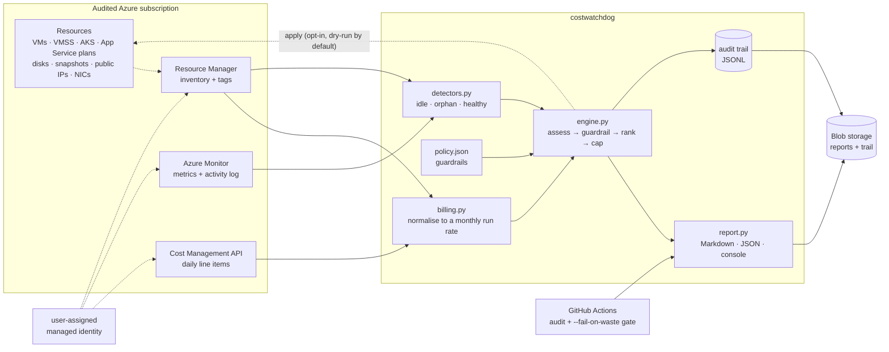
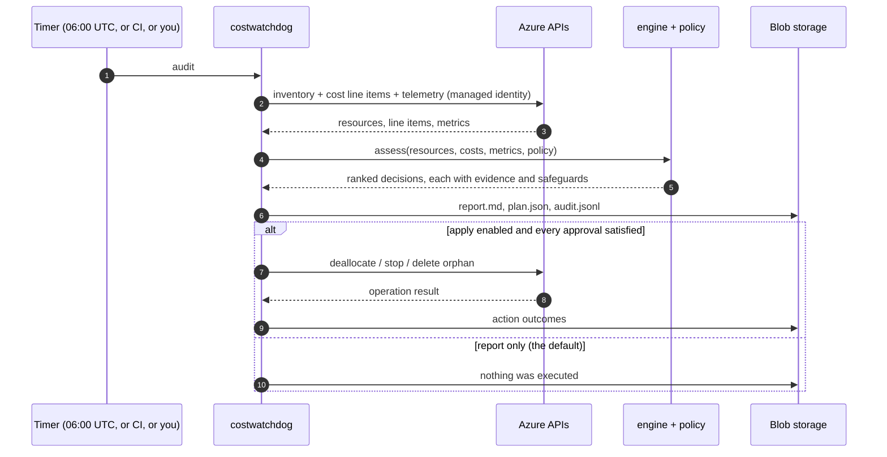

# costwatchdog-python

**Find idle and orphaned Azure resources, price the waste per resource, and stop it — behind guardrails strict enough that auto-remediation is safe to actually switch on.**

Most "cost saving" scripts are a cron job with a delete permission attached. This one is
built the other way round: every action has to get past a named guardrail, every decision
carries its own evidence, and the default mode changes nothing at all. You can read one
decision in the report and see exactly which numbers and which rule produced it.

```
monthly run rate      USD 886.80
identified waste      USD 512.78
actionable now        USD 183.18
pending approval      USD 189.34
resources considered  14 (4 healthy, 1 below threshold)
```

---

## Architecture



The same engine runs in three places: your laptop against fixture files, a GitHub Actions
job as a spending gate, and a scheduled Function in Azure.

### One decision, end to end



---

## What it finds

| Category | Signal | Action | Reclaimable |
| --- | --- | --- | --- |
| `idle-vm` / `idle-vmss` | CPU peak ≤ threshold, quiet network, no activity for N days | `deallocate` | 100% of compute |
| `idle-aks` | same signals on the cluster resource | `stop` | 90% (node OS disks keep billing) |
| `idle-session-host-pool` | zero connections in the window | `schedule-shutdown` | 60% (out-of-hours only) |
| `empty-app-service-plan` | `numberOfSites = 0` | `delete-orphan` | 100% |
| `unused-app-service-plan` | attached apps but zero requests | notify | consolidation |
| `orphan-disk` | `diskState = Unattached`, no `managedBy` | `delete-orphan` | 100% |
| `unused-public-ip` | static address with no `ipConfiguration` | `delete-orphan` | 100% |
| `stale-snapshot` | older than `stale_snapshot_days` | `delete-orphan` | 100% |
| `orphan-nic` | not attached to a VM | `delete-orphan` | hygiene only |
| `already-deallocated` | stopped VM — compute is not accruing | none | — |
| `unclassified` | expensive, but no telemetry to judge it | notify | — |

Deallocating keeps the disks and configuration: the machine stops billing, nothing is
destroyed. Deletion is only ever proposed for resources that are already detached from
anything that uses them.

---

## Quickstart — no Azure account needed

The repository ships a fixture subscription (14 resources, a 3-day cost export, a metrics
dump) so the whole pipeline runs offline.

```bash
# 1. audit the fixtures and write a report + an executable plan
PYTHONPATH=src python3 -m costwatchdog.cli audit \
  --cost-csv examples/cost-export.csv \
  --inventory examples/inventory.json \
  --metrics examples/metrics.json \
  --policy examples/policy.json \
  --today 2026-10-27 \
  --format both --out reports/report.md --plan-out reports/plan.json

# 2. read reports/report.md, then dry-run the plan (this executes nothing)
PYTHONPATH=src python3 -m costwatchdog.cli apply --plan reports/plan.json
```

`audit` is read-only everywhere: even in live mode it never changes anything.

The fixture audit finds five things it would do now, one that needs a human, and three it
only reports — including a VM protected by tag, a resource group on the deny list, and a
$70/month VM with no telemetry that it deliberately refuses to guess about.

Exit codes: `0` fine, `2` usage/configuration problem, `3` waste budget exceeded,
`4` an action failed. `--fail-on-waste` turns the audit into a CI gate.

---

## Guardrails

Each rule is a named string that shows up in the report next to the decision it affected.

| Guardrail | Effect |
| --- | --- |
| `protected-tag` | Resources tagged `costwatchdog:protected`, `do-not-stop` or `protected` are reported, never touched. |
| `denylisted-scope` | Deny-listed subscriptions/resource groups are notify-only. |
| `environment=prod` | Production resources require `allow_prod_actions` in the policy *and* `--allow-prod` on apply. |
| `orphan-deletion-disabled` | Deletion is opt-in twice: `allow_orphan_deletion` in the policy, and a plan that recorded it. |
| `low-confidence-requires-approval` | A deletion inferred rather than stated by Azure needs a human. |
| `missing-owner-tag` / `missing-environment-tag` | Untagged resources are never auto-actioned — that is how a watchdog deletes something nobody claimed. |
| `max-actions-per-run` | Overflow is deferred to the next run instead of executed in one blast. |
| dry-run by default | `apply` does nothing without `--yes`. |
| audit trail | Every audit and every action is appended to JSONL. |

Also enforced in code: disks and NICs in `MC_*` resource groups (AKS-managed) are never
considered orphans, disks attached outside the audited scope are skipped, and anything
reclaiming less than `min_monthly_savings` is dropped as noise rather than reported.

---

## Policy reference

A policy is JSON; unknown keys are rejected so a typo in a safety setting stops the run.
Keys starting with `_` are treated as comments.

| Key | Default | Meaning |
| --- | --- | --- |
| `currency` | `USD` | Currency for reporting. |
| `min_monthly_savings` | `5.00` | Ignore anything worth less than this per month. |
| `min_idle_days` | `14` | Days of quiet required before "idle". |
| `cpu_idle_peak_percent` | `5.0` | CPU ceiling for idleness (peak, not average). |
| `idle_network_bytes_per_day` | `5000000` | Network ceiling for idleness. |
| `stale_snapshot_days` | `90` | Snapshot retention window. |
| `max_actions_per_run` | `25` | Cap on automatic actions per run. |
| `high_severity_savings` | `100.00` | Savings at which a decision is high severity. |
| `allow_prod_actions` | `false` | Allow automatic production actions. |
| `allow_orphan_deletion` | `false` | Allow deletion of orphans. |
| `require_owner_tag` | `true` | Untagged resources need approval. |
| `notify_unclassified` | `true` | Report expensive resources with no telemetry. |
| `notify_unclassified_above` | `50.00` | Monthly cost above which that report happens. |
| `protected_tag_keys` | `costwatchdog:protected`, `do-not-stop`, `protected` | Protection tags. |
| `environment_tag_keys` | `env`, `environment` | Where the environment is read from. |
| `owner_tag_keys` | `owner`, `costwatchdog:owner`, `team` | Where ownership is read from. |
| `protected_environments` | `prod`, `production` | Environments needing approval. |
| `denied_subscriptions` / `denied_resource_groups` | `[]` | Read-only scopes. |
| `monitored_resource_types` | see `policy.py` | Types the watchdog assesses. |

Roll out in stages: run with `allow_orphan_deletion: false` and `allow_prod_actions: false`
for a week or two, compare the reports against what you know about your estate, then relax
one gate at a time.

---

## Live mode

```bash
pip install azure-identity azure-mgmt-resource azure-mgmt-compute \
            azure-mgmt-containerservice azure-mgmt-costmanagement azure-mgmt-monitor
az login

PYTHONPATH=src python3 -m costwatchdog.cli audit --live --days 30 \
  --policy examples/policy.json --format both --out reports/live.md
```

The identity running the audit needs, on each audited subscription:

| Role | Why |
| --- | --- |
| Reader | inventory, resource properties |
| Cost Management Reader | cost query API |
| Virtual Machine Contributor | deallocate VMs and scale sets (it cannot delete them) |

Running locally, `DefaultAzureCredential` uses your `az login`. In Azure, it uses the
user-assigned managed identity, so no secret is stored anywhere.

## Deploy the scheduled job

```bash
# 1. infrastructure: resource group, storage, plan, insights, identity, RBAC
az deployment sub create --location eastus \
  --template-file infra/main.bicep \
  --parameters baseName=costwatchdog applyActions=false

# 2. vendor the package into the function app
pip install . --target functions/.python_packages/lib/site-packages

# 3. publish (needs Azure Functions Core Tools)
cd functions && func azure functionapp publish <functionAppName> --python
```

`applyActions=false` deploys a reporting-only watchdog: it publishes a report and a plan
to the `reports` blob container every night at 06:00 UTC and changes nothing. Flip that
parameter once you trust its findings.

The Functions host stores its own storage connection string in app settings — the one
secret in the deployment. To remove it, grant the identity `Storage Blob Data Owner`,
`Storage Queue Data Contributor` and `Storage Table Data Contributor` on the storage
account, then replace `AzureWebJobsStorage` with the identity-based settings
(`AzureWebJobsStorage__accountName`, `__credential=managedidentity`, `__clientId`).

---

## Repository layout

```
src/costwatchdog/
  models.py        data structures, tag parsing (no Azure, no I/O)
  billing.py       Cost Management export -> per-resource monthly run rate
  detectors.py     idle/orphan heuristics, one function per resource type
  policy.py        validated guardrail configuration
  engine.py        assess -> guardrail -> rank -> cap   <- the safety rules live here
  report.py        Markdown, JSON and console renderers
  auditlog.py      append-only JSONL trail
  sources.py       fixture loaders
  azure_client.py  the only module that talks to Azure (imported lazily)
  cli.py           `audit` and `apply`
functions/         Azure Functions timer trigger + host.json
infra/             subscription-scope Bicep (app stack + least-privilege RBAC)
examples/          fixture subscription: inventory, cost export, metrics, policy
tests/             105 tests, standard library only
```

## Tests

```bash
PYTHONPATH=src python3 -m unittest discover -s tests -t . -v
```

No dependencies, no credentials, no network. The tests pin the arithmetic (a 3-day window
normalised to a month, rounding that must not compound), every detector boundary
(idle/busy, attached/unattached, stale/fresh), and every guardrail (protection, production,
deny lists, missing tags, thresholds, rate limiting).

## What has and has not been verified

Honesty matters more than a green checkmark here, so:

**Verified.** The audit engine, detectors, cost arithmetic, report rendering, CLI,
exit codes and guardrails are exercised by 105 passing tests and by running the CLI
end to end over `examples/` — the numbers in this README are that run's real output.
`--fail-on-waste` was confirmed to exit 3 when the budget is exceeded. `apply` was
confirmed to execute nothing and to block the production decision.

**Not verified here.** The Azure SDK paths (`--live`, `apply --yes`) need a real
subscription and credentials, so they are unexercised by the tests. The Bicep templates
were written against the documented resource schemas but could not be compiled in this
environment (no `az`/`bicep` binary); the CI workflow compiles them on every push, so
watch that job on the first run.

**Known limitations.**

* `cpu_peak_percent` is the **maximum of hourly averages**, which is conservative for
  idleness but is not a true p95.
* AKS telemetry comes from Container Insights metric names (`node_cpu_usage_percentage`);
  verify them against your cluster version before trusting AKS findings.
* Snapshot age needs `properties.timeCreated` projected by your inventory query; without
  it, snapshots are skipped rather than misjudged.
* Per-resource attribution needs a `ResourceId` column in the cost export. Rows without a
  resource id are reported as unallocated spend and never acted on.
* Out of scope on purpose: reservation/savings-plan utilisation, storage account growth,
  log ingestion volume, bandwidth, and anything needing application-level knowledge.
* Idle detection will not save you from a *busy but pointless* workload. It measures
  usage, not value.

## License

None yet — choose one before publishing this repository.
